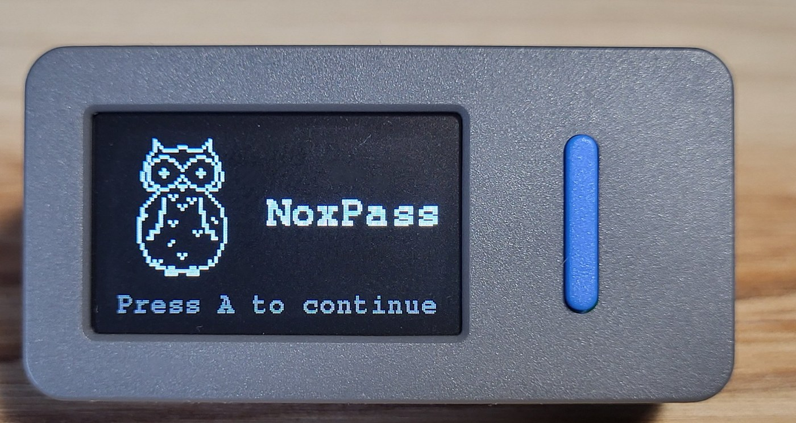
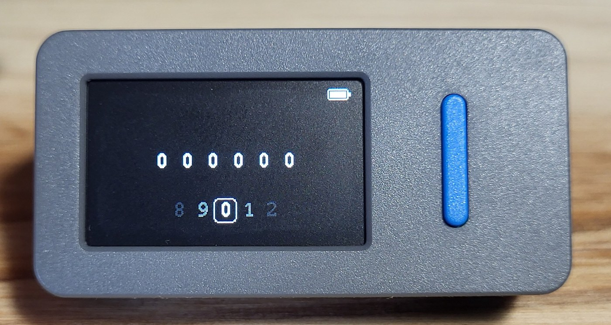
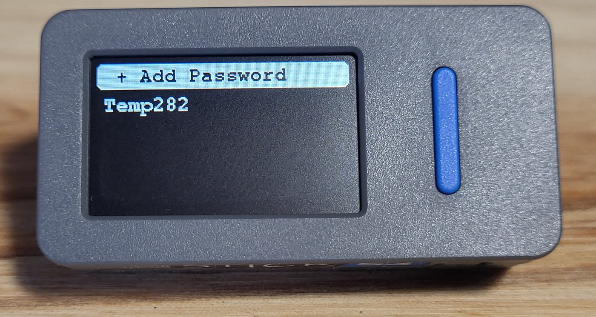
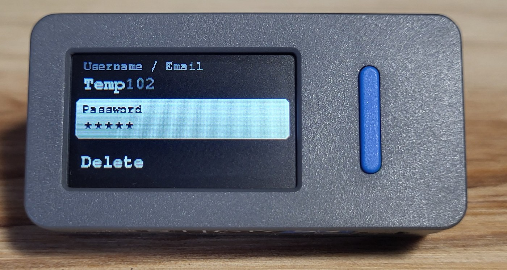
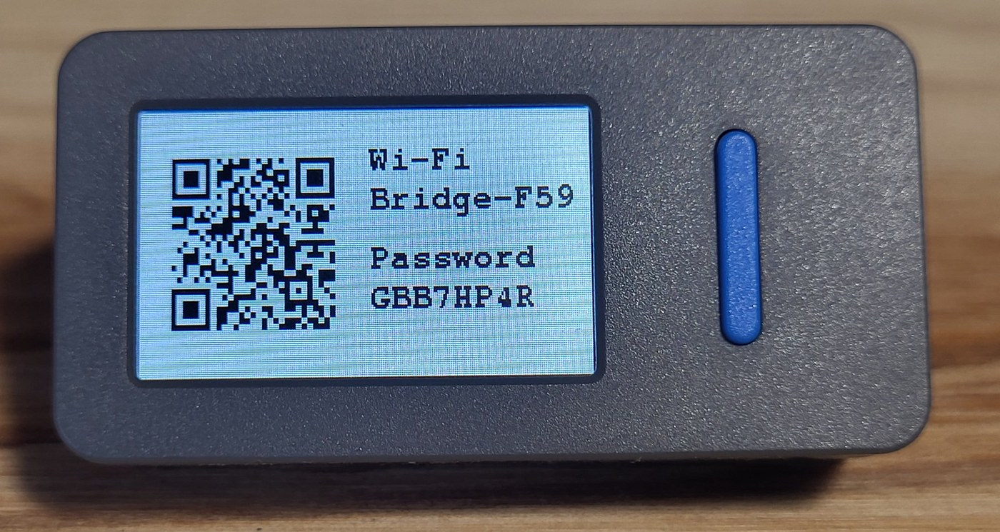
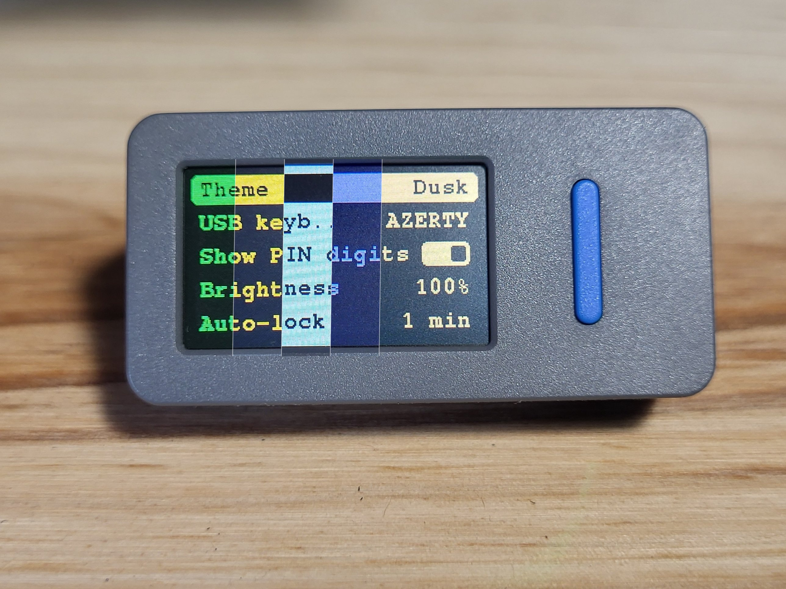

<p align="center">

</p>

<h1 align="center">NoxPass</h1>

**An offline password manager for the M5StickS3: encrypted vault, typed over USB, nothing in the cloud.**

Plug the stick into any computer, enter your PIN on its two buttons, pick an entry, and the stick types
the login or password for you, like a keyboard. Your secrets live encrypted on the stick and never leave
it, unless you decide to manage them from your phone or PC through the stick's own Wi-Fi.

**New here? Read the [quick start guide](START.md).**

## What's inside

- **Encrypted vault**: AES-256-GCM, with a random master key protected by a key derived from your PIN
  (PBKDF2-SHA256). The PIN itself is never stored.
- **USB keyboard**: the stick types a field for you (QWERTY by default, AZERTY in the settings), whether the field is hidden
  or not.
- **Two buttons, one hand**: every screen is driven by button A and button B only.
- **Bridge**: the stick opens its own Wi-Fi (QR code to join it) and serves a web page to manage your
  entries from a phone or a computer. A new device has to be accepted on the stick first.
- **Username / email presets**: save your usual usernames or emails from the website. When you create an entry
  on the stick, they are offered first, then the characters. They are stored encrypted too.
- **Entry types**: username / email, password, URL, card number, expiry, CVV, note, free text and
  secret.
- **Settings**: 19 two-color themes, brightness, PIN visible or hidden, shuffled PIN wheel, auto-lock,
  sort by recent use or alphabetically, power off when unplugged.
- **Minimal look**: two colors, a simple logo.

<details>
<summary><b>Screenshots</b></summary>

<br>

<table>
<tr>
<td align="center"><br><sub>Splash screen</sub></td>
<td align="center"><br><sub>PIN dial</sub></td>
</tr>
<tr>
<td align="center"><br><sub>Password list</sub></td>
<td align="center"><br><sub>An entry</sub></td>
</tr>
<tr>
<td align="center"><br><sub>Bridge: Wi-Fi QR code</sub></td>
<td align="center"><br><sub>Three of the 19 themes, on one stick</sub></td>
</tr>
</table>

</details>

## Buttons

| Button | Effect |
|---|---|
| `A` | move forward |
| `B` | move back |
| `A` long | validate |
| `B` long | go back / delete |
| `A + B` | same as `A` long on most screens |

Each screen describes its own details in [Projet.md](Explication%20Projet/Projet.md).

## Security

The goal is *good* security, not perfect security.

```
PIN -> (PBKDF2 + salt) -> KEK -> decrypts -> master key -> decrypts -> vault
```

- The **master key** is random (256 bits) and encrypts the vault with AES-256-GCM.
- The **KEK** comes from the PIN and only protects the master key.
- The PIN and the KEK are **never stored**. A correct PIN is a valid GCM tag on the master key.
- Changing the PIN re-encrypts the same master key with a new salt. The vault is not touched.
- Everything is decrypted in RAM only, and wiped when the stick locks.
- The PIN has 6 to 12 digits. If someone copies the flash, only the PBKDF2 cost slows down offline
  guesses, so **a longer PIN is your best protection**.
- Holding `A + B` for 10 seconds on the login screen erases everything (factory reset).

> This is a personal project that has not been audited. Use it knowing that.

## Build and flash

You need [PlatformIO](https://platformio.org) and an **M5StickS3**.

```sh
git clone https://github.com/git-psi/NoxPass
cd NoxPass
pio run -e m5stick-s3-hid -t upload
```

- `m5stick-s3-hid` is the normal firmware: the USB port becomes a keyboard. Flashing it needs the
  manual download mode of the stick.
- `m5stick-s3` is the same firmware without the USB keyboard.

Before sharing your own build, replace `HELP_URL` in `src/config.h` (shown as a QR code at first
launch).

<details>
<summary>Code layout</summary>

```
src/
  main.cpp      entry point
  config.h      all the tunable constants
  core/         screens manager, buttons, power, settings
  screens/      login, list, entry, create, apps, bridge, settings
  security/     PIN, key derivation, encryption
  storage/      files on the stick
  vault/        entries and their binary format
  hid/          USB keyboard
  net/          Wi-Fi bridge and web page
  ui/           theme, drawing helpers, logo, battery
```

</details>

## The idea before the code

This project started as a written idea, not as code: what the screens look like, what every button does,
how the secrets are protected. That document is kept here as it was written, with the spelling fixed
(in French):

- [Projet.md](Explication%20Projet/Projet.md): the full description of the project, screen by screen.
- Reference images, drawn before any code, to guide the look:
  [Applications](Explication%20Projet/ImageRef/Applications.png),
  [Connection](Explication%20Projet/ImageRef/Connection.png),
  [Info](Explication%20Projet/ImageRef/Info.png),
  [Liste](Explication%20Projet/ImageRef/Liste.png),
  [Settings](Explication%20Projet/ImageRef/Settings.png),
  [Web](Explication%20Projet/ImageRef/Web.png).

The final firmware follows them closely, but may differ in places: the code came after, and it has
the last word.
Pictures of the idea:

<table>
<tr>
<td></td>
<td></td>
<td></td>
</tr>
</table>

## License

MIT

---

<p align="center">
Designed by me, coded by Claude and me, and fully reviewed by me. 🦉
</p>
